### Business Analyst & Product Owner · Healthcare & AI

I work at the intersection of healthcare, business needs and technology. My work involves AI adoption in medical information systems, requirements gathering, solution testing and quality evaluation.

I'm a final-year Business Informatics student at Plekhanov Russian University of Economics, with a focus on business analysis and product management.

**My toolkit**  
Python · SQL · Statistics · JavaScript · TypeScript

**My focus**  
Requirements · Solution evaluation · Healthcare workflows · AI-enabled products

**Languages**  
English — C1 · German — A2 *(self-assessed)*

---

### Featured project

**[Clinical Compass →](https://github.com/KPSKolesnikova/clinical-compass)**  
A functional demonstration prototype for clinician and patient workflows, with explainable support for reviewing patient-reported information.

[Product presentation](https://github.com/KPSKolesnikova/clinical-compass/blob/main/docs/pitch/clinical-compass-defense.pdf) · [Algorithm documentation](https://github.com/KPSKolesnikova/clinical-compass/blob/main/docs/physician-support-algorithm.md)

*Demonstration with fictional records. Clinical effectiveness has not been externally validated.*

---

### Portfolio direction

I'm developing a public portfolio around three questions:

- **Business analysis:** How can a healthcare workflow be translated into clear requirements and acceptance criteria?
- **Product analytics:** Which metrics help identify a problem and evaluate a proposed improvement?
- **AI product quality:** How should an AI feature be tested, reviewed and monitored before users rely on it?

---

### Learning roadmap

*Planned learning — no completion or certification claimed.*

- [Camunda Academy — BPMN](https://academy.camunda.com/)
- [Pendo Learning Lab — Product Judgment](https://www.pendo.io/learninglab/)
- [HP LIFE — Agile Project Management](https://www.life-global.org/news/agile-project-management)
- [PMI — KICKOFF](https://www.pmi.org/kickoff)

<!-- Add a Selected Work section only when actual public cases are ready. Link each to its repository and explain your personal contribution. Replace roadmap entries with earned credential links only after completion. -->