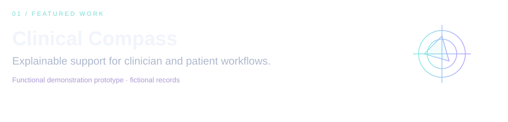

  
  
  <!-- linkedin-button -->

CV: working template · [Edit the source](./cv/README.md)

[View presentation](https://github.com/KPSKolesnikova/clinical-compass/blob/main/docs/pitch/clinical-compass-defense.pdf) · [Read the algorithm](https://github.com/KPSKolesnikova/clinical-compass/blob/main/docs/physician-support-algorithm.md)

Demonstration prototype; clinical effectiveness has not been externally validated.

### A little about me

Business Analyst & Product Owner in healthcare, working on AI adoption in medical information systems, requirements, solution testing and quality evaluation. Final-year Business Informatics student at Plekhanov Russian University of Economics.

Planned courses · expand a step for details. Personal certificate downloads will appear after completion.

<strong>01 — BPMN &amp; process modelling · Camunda Academy</strong>

Model healthcare workflows, clarify responsibilities and describe exceptions before implementation.

**Practical outcome:** an AS-IS / TO-BE process model for a fictional patient journey.  
**Cost:** free learning. **Credential:** the Camunda Knowledge — BPMN learning badge requires the BPMN learning path and assessment.

[Explore Camunda Academy →](https://academy.camunda.com/) · [Badge requirements →](https://www.credly.com/org/camunda/badge/camunda-knowledge-bpmn)

<strong>02 — Product judgment · Pendo × Mind the Product</strong>

**Product Judgment: making confident decisions without complete data.** Develop a structured approach to product decisions when evidence is incomplete.

**Practical outcome:** a short decision brief covering options, assumptions and the next experiment.  
**Cost:** free. **Credential:** a verifiable completion badge; Pendo supports sharing the credential and downloading it as an image or PDF.

[Explore Pendo Learning Lab →](https://www.pendo.io/learninglab/)

<strong>03 — Agile delivery · HP LIFE</strong>

**Agile Project Management.** Review iterative delivery, Scrum and Kanban, and when to use them.

**Practical outcome:** a small product backlog and delivery plan for a healthcare feature.  
**Cost:** free. **Credential:** a Certificate of Completion, downloadable from HP LIFE after completing the course.

[Explore the course →](https://www.life-global.org/news/agile-project-management) · [Certificate and download instructions →](https://www.life-global.org/help)

<strong>04 — Project foundations · PMI KICKOFF</strong>

Explore agile and predictive project approaches, planning and delivery fundamentals in less than an hour.

**Practical outcome:** a one-page project plan with scope, milestones and risks.  
**Cost:** free. **Credential:** a shareable KICKOFF completion badge.

[Start PMI KICKOFF →](https://www.pmi.org/kickoff)

<!-- analytics:start -->
### Activity in numbers

  

What these numbers mean

- **Activity:** 14 profile-visible contributions across 2025-10-26–2026-10-28. GitHub contributions include more than commits.
- **Consistency:** 2 consecutive active day(s) ending 2026-10-28; longest streak in this calendar: 2 day(s).
- **Cadence:** Highest contribution total on Wed. This describes recorded activity, not a fixed work schedule.

Updated daily from the [GitHub profile calendar](https://github.com/KPSKolesnikova?tab=overview). Snapshot through **2026-10-28**; not real-time. Automated profile updates may also count as contributions.
<!-- analytics:end -->
