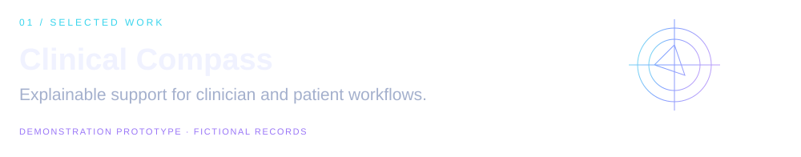
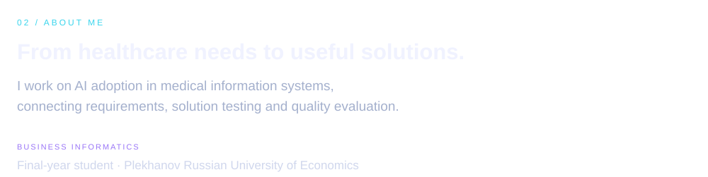
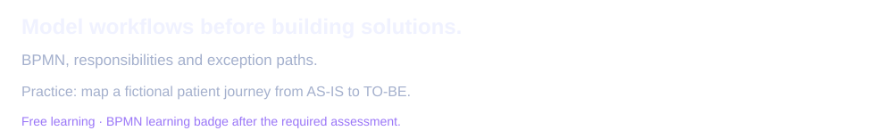
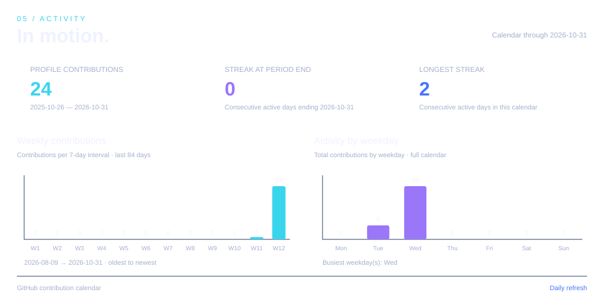

<strong>01 · BPMN &amp; process modelling</strong> · Camunda Academy

<strong>02 · Product judgment</strong> · Pendo × Mind the Product

<strong>03 · Agile delivery</strong> · HP LIFE

<strong>04 · Project foundations</strong> · PMI KICKOFF

<!-- analytics:start -->

<strong>Activity &amp; contributions</strong>

<!-- analytics:end -->

  

